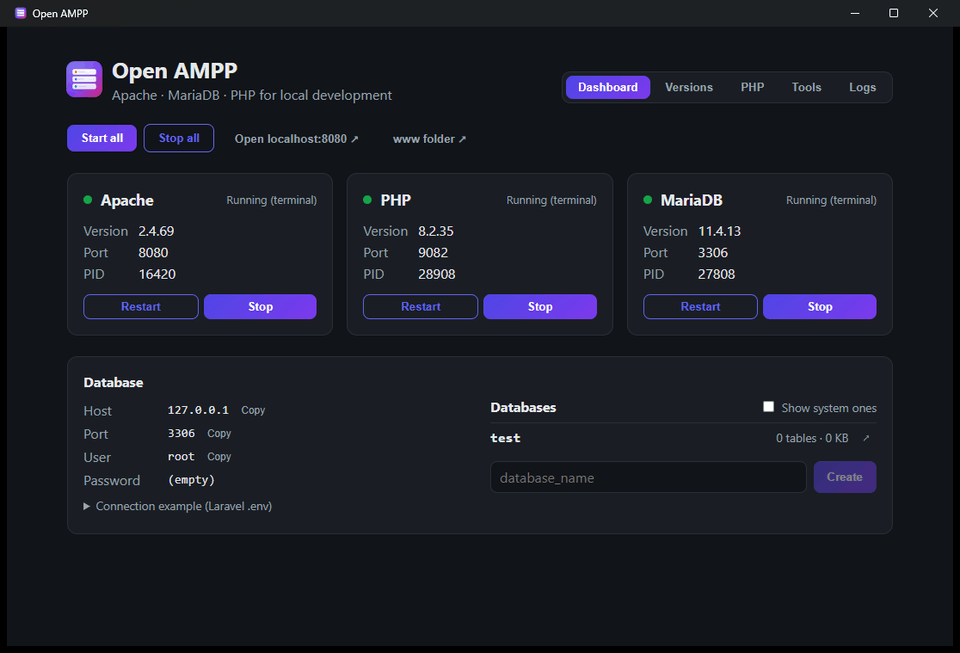
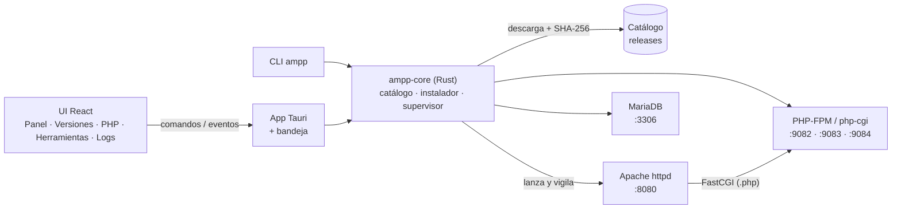

<div align="center">


# Open AMPP

**Apache + MariaDB + PHP para desarrollo local, sin complicaciones.**<br>
Varias versiones de cada herramienta, una app de escritorio amigable y el mismo flujo en Windows, macOS y Linux.

[English](README.md) · **Español**

[](https://github.com/Jmzp/open-ampp/actions/workflows/ci.yml)
[](https://github.com/Jmzp/open-ampp/actions/workflows/binaries.yml)


<br><br>


</div>

---

## ✨ ¿Qué es?

Open AMPP es una alternativa moderna a XAMPP / MAMP / LAMPP. Abres la app, eliges qué versiones quieres y con un clic tienes un servidor web con PHP y una base de datos funcionando en tu máquina.

- 🧩 **Multiversión**: instala PHP 8.2, 8.3, 8.4 y 8.5 (y varias versiones de MariaDB) lado a lado y cambia entre ellas cuando quieras.
- 🐘 **PHP al estilo XAMPP**: el `php.ini` por defecto es el de XAMPP, con sus extensiones (`mysqli`, `pdo_mysql`, `mbstring`, `curl`, `openssl`…) más `intl`, `gd`, `zip`, `sodium` y `opcache`.
- 🗄️ **phpMyAdmin y Composer** a un clic, ya conectados a las versiones activas.
- 📦 **Nada que instalar en el sistema**: la app descarga sus propios binarios portables, verificados con SHA-256, dentro de su carpeta de datos. No toca Homebrew, `apt` ni el registro de Windows.
- 🖥️ **Interfaz clara** en español e inglés (sigue el idioma de tu sistema): estado de los servicios en vivo, iniciar/detener, logs, gestor de versiones, editor de `php.ini` e icono en la bandeja.
- ⌨️ **Comando `ampp`** para la terminal, además de los atajos `php`, `composer` y `mariadb` que usan siempre las versiones activas.
- 🛡️ **Seguro por defecto**: los servicios escuchan solo en `127.0.0.1`, en puertos sin privilegios (8080, 3306, 90xx).
- 🧹 **Apagado limpio**: al salir de la app se detiene todo lo que inició; MariaDB siempre se apaga de forma ordenada.
- 🔒 **Parches de seguridad sin esperar**: las nuevas versiones de PHP se compilan solas cada día; la app recibe el catálogo actualizado y te ofrece **Actualizar a …** para las versiones que tengas instaladas.
- 🔄 **Actualizaciones automáticas** de la propia app mediante versiones firmadas.

## 🧭 Plataformas y versiones

| | Windows x64 | macOS (Intel / Apple Silicon) | Linux (x64 / arm64) |
|---|:---:|:---:|:---:|
| **PHP** 8.2 · 8.3 · 8.4 · 8.8 | ✅ | ✅ | ✅ |
| **MariaDB** 10.11 · 11.4 · 11.8 · 12.3 (LTS) | ✅ | ✅ | ✅ |
| **Apache** 2.4 | ✅ | ✅ | ✅ |
| **phpMyAdmin** · **Composer** | ✅ | ✅ | ✅ |

> [!IMPORTANT]
> **Requisito en Windows: Microsoft Visual C++ Redistributable (x64).** En Windows se usan los binarios oficiales (php.net, mariadb.org, Apache Lounge), que dependen de él. La mayoría de los equipos ya lo tienen; si no, Open AMPP te avisa al iniciar los servicios.
>
> **[Descargar vc_redist.x64.exe](https://aka.ms/vs/17/release/vc_redist.x64.exe)** (enlace directo de Microsoft) · [más información](https://learn.microsoft.com/es-es/cpp/windows/latest-supported-vc-redist)

> En macOS y Linux, donde no existen builds portables oficiales, Open AMPP publica los suyos (ver [Binarios propios](#-binarios-propios)). En Linux funcionan en cualquier distro con glibc ≥ 2.28 (Ubuntu 20.04+, Debian 10+, RHEL/Alma/Rocky 8+, Fedora, Arch…); PHP es totalmente estático.
>
> **Estado de las pruebas:** el stack completo (Apache, PHP, MariaDB y phpMyAdmin) está probado de punta a punta en macOS (Apple Silicon), Linux arm64 (Ubuntu 24.04) y Windows 11 x64. Las variantes x64 de macOS y Linux se compilan en CI pero aún no se han probado en máquinas reales: si las usas, [cuéntanos cómo te va](https://github.com/Jmzp/open-ampp/issues).

## 🚀 Empezar

### Instaladores

Descarga el instalador de tu sistema desde [Releases](https://github.com/Jmzp/open-ampp/releases):

| Sistema | Archivo |
|---|---|
| macOS | `.dmg` (`aarch64` para Apple Silicon, `x64` para Intel) |
| Windows | `.msi` o `-setup.exe` |
| Linux | `.AppImage`, `.deb` o `.rpm` |

> Mientras los builds no estén firmados con un Developer ID de Apple, macOS pide confirmación la primera vez: clic derecho sobre la app → **Abrir**.

### Desde el código

**Requisitos:** [Rust](https://rustup.rs) estable, [Node.js](https://nodejs.org) 22 y las [dependencias de Tauri](https://tauri.app/start/prerequisites/) de tu sistema.

```sh
git clone https://github.com/Jmzp/open-ampp.git
cd open-ampp/apps/desktop
npm install
npm run tauri dev
```

### Primeros pasos

1. **Versiones** → instala una versión de PHP, Apache y MariaDB.
2. **Panel** → **Iniciar todo**.
3. Abre **http://localhost:8080**: verás la página de bienvenida servida por PHP.
4. Opcional: **Herramientas** → instala **phpMyAdmin** (en `/phpmyadmin`) y **Composer**.

Tus archivos van en la carpeta `www/` dentro del directorio de datos (la app tiene un botón para abrirla). MariaDB escucha en `127.0.0.1:3306` con usuario `root` sin contraseña; desde PHP en macOS/Linux también funciona `localhost` por el socket, igual que en XAMPP.

Al cerrar la ventana, Open AMPP sigue en la bandeja del sistema con los servicios activos; **Salir** en el menú de la bandeja los detiene.

## ⌨️ Terminal

**Herramientas → Terminal → Agregar al PATH** deja disponibles estos comandos en cualquier terminal nueva:

| Comando | Qué ejecuta |
|---|---|
| `php`, `composer` | El PHP activo con el `php.ini` de Open AMPP |
| `mariadb`, `mysql`, `mariadb-dump`, `mysqldump` | El cliente de la MariaDB activa, ya conectado como root |
| `ampp` | Controla Open AMPP sin abrir la app |

```sh
ampp status                 # estado de los servicios (también los que inició la app)
ampp up                     # inicia todo en primer plano; Ctrl+C lo detiene
ampp stop [apache|php|mariadb]
ampp list                   # versiones instaladas y disponibles
ampp install php            # el PHP más reciente; también: ampp install mariadb 11.4.13, ampp install phpmyadmin
ampp upgrade                # lleva las versiones instaladas a su último parche
ampp use php 8.3.36         # versión activa
ampp php -v                 # pasa los argumentos al PHP activo (igual con composer y mariadb)
```

La app y `ampp` comparten estado: lo que inicia uno, el otro lo ve y lo puede detener.

## 🐘 Configuración de PHP

La pestaña **PHP** edita los ajustes habituales (memoria, tamaño de subida, tiempo de ejecución, errores, zona horaria), activa o desactiva extensiones en Windows (en macOS/Linux vienen incluidas) y admite líneas libres de `php.ini`. Tus cambios se añaden al final del `php.ini` de XAMPP, así que tienen prioridad, y PHP se reinicia solo para aplicarlos.

## 🏗️ Cómo funciona



- **PHP vía FastCGI, no `mod_php`**: cada versión de PHP corre en su propio puerto (`9000 + mayor·10 + menor`, p. ej. 8.3 → 9083) y Apache le pasa los `.php` con `mod_proxy_fcgi`. Así pueden convivir varias versiones a la vez.
- **Toda la lógica vive en `ampp-core`**, un crate de Rust sin dependencia de Tauri que comparten la app y el CLI `ampp`.
- **Configuración generada** desde [`templates/`](templates) en cada arranque, en la carpeta de datos del usuario.

<details>
<summary><b>📁 Dónde guarda las cosas</b></summary>

| Sistema | Carpeta de datos |
|---|---|
| macOS | `~/Library/Application Support/dev.openampp.open-ampp/` |
| Linux | `~/.local/share/open-ampp/` (o `$XDG_DATA_HOME/open-ampp`) |
| Windows | `%APPDATA%\openampp\open-ampp\data\` |

Con la variable `OPEN_AMPP_HOME` puedes usar otra carpeta (instalaciones portables, pruebas).

```text
bin/<herramienta>/<versión>/    binarios descargados
config/<herramienta>/<versión>/ httpd.conf, php.ini, php-fpm.conf, my.cnf generados
data/mariadb/<mayor.menor>/     datos de MariaDB (uno por versión, para no mezclar formatos)
tools/                          phpMyAdmin y Composer
shims/                          php, composer, mariadb, ampp… para la terminal
www/                            tu DocumentRoot
logs/                           un log por servicio (también visibles en la app)
state.json                      versiones instaladas/activas, puertos y ajustes de PHP
```

</details>

## 🗂️ Estructura del repositorio

| Ruta | Contenido |
|---|---|
| [`crates/ampp-core`](crates/ampp-core) | Motor en Rust: rutas, estado, catálogo, instalador, configuración, supervisor de procesos, atajos, i18n |
| [`crates/ampp-cli`](crates/ampp-cli) | El comando `ampp` |
| [`apps/desktop`](apps/desktop) | App Tauri 2 (`src-tauri/`) y UI React + TypeScript (`src/`) |
| [`templates`](templates) | Plantillas de `httpd.conf`, `php.ini` (el de XAMPP), `php-fpm.conf` y `my.cnf` |
| [`catalog`](catalog) | `manifest.json` con las versiones descargables (solo el último parche de cada rama) y su generador |
| [`binaries`](binaries) | Scripts que compilan Apache, MariaDB y PHP portables |
| [`.github/workflows`](.github/workflows) | CI, compilación de binarios y publicación de instaladores |

## 🧪 Desarrollo y pruebas

```sh
cargo test -p ampp-core -p ampp-cli                       # tests unitarios, del supervisor y del CLI (rápidos, sin red)
cargo test -p ampp-core -- --ignored                      # descarga PHP real, lo arranca y le hace una petición FastCGI
cd apps/desktop && npm run build                          # compila la UI
OPEN_AMPP_LANG=en npm run tauri dev                       # fuerza el idioma del lado de Rust (es o en)
```

Prueba de punta a punta del stack completo con paquetes locales (Apache sirve PHP, PHP consulta MariaDB por PDO, phpMyAdmin inicia sesión):

```sh
OPEN_AMPP_APACHE_PKG=dist/apache-….tar.gz \
OPEN_AMPP_PHP_PKG=dist/php-….tar.gz \
OPEN_AMPP_MARIADB_PKG=dist/mariadb-….tar.gz \
  cargo test -p ampp-core --test stack -- --ignored --nocapture
```

## 📦 Binarios propios

Apache, MariaDB y PHP no publican builds portables para macOS ni Linux, así que Open AMPP los compila con los scripts de [`binaries/`](binaries) y los publica como releases `bin-<herramienta>-<versión>` desde el workflow **Binaries**.

- **Siempre al día**: los builds de PHP consultan en php.net la última versión de cada rama (8.2, 8.3, 8.4). El workflow corre a diario, compila solo lo que falte, lo publica y actualiza [`catalog/manifest.json`](catalog/manifest.json) en `main`. La app y `ampp` descargan ese catálogo al arrancar (sin red usan el incluido), así que los parches de seguridad llegan sin esperar una nueva versión de la app. Los builds de Apache y MariaDB se lanzan a mano.

- **Relocalizables**: funcionan desde cualquier carpeta (`@rpath` en macOS, `$ORIGIN` en Linux).
- **Autocontenidos**: OpenSSL, PCRE2 y expat se enlazan estáticamente; en Linux las librerías que no son de glibc van dentro del paquete y PHP es totalmente estático ([static-php-cli](https://github.com/crazywhalecc/static-php-cli)). El build falla si detecta una dependencia que no existiría en un sistema limpio (p. ej. librerías de Homebrew).
- **Compatibles**: Apache y MariaDB para Linux se compilan sobre AlmaLinux 8 (glibc 2.28); macOS apunta a macOS 11+.
- **Verificados**: cada fuente se comprueba contra su SHA-256 oficial ([`binaries/sources.sh`](binaries/sources.sh)).

```sh
WORK=/tmp/ampp-build binaries/build-apache.sh dist
WORK=/tmp/ampp-build binaries/build-mariadb.sh 11.4.13 dist   # requiere cmake ≥ 3.23 y bison ≥ 3
WORK=/tmp/ampp-build binaries/build-php.sh 8.4 dist          # una rama se resuelve a su último parche
GH_TOKEN=$(gh auth token) python3 catalog/generate.py         # después, regenera el catálogo
```

## 🚢 Publicar versiones

Al subir un tag `v*` corre el workflow **Release**: compila los instaladores de todas las plataformas (con el CLI `ampp` incluido), firma los artefactos de actualización y deja un borrador de release listo para publicar. Las actualizaciones se firman con la clave del secreto `TAURI_SIGNING_PRIVATE_KEY`; los secretos de firma y notarización de Apple son opcionales (ver [`release.yml`](.github/workflows/release.yml)).

## 🗺️ Hoja de ruta

- [x] **Fundaciones**: monorepo, `ampp-core`, app Tauri + React, CI en las 3 plataformas
- [x] **Catálogo e instalador**: descargas con progreso, verificación SHA-256, gestor de versiones, catálogo remoto con actualizaciones de parche
- [x] **Servicios**: Apache + PHP (FastCGI) + MariaDB, health checks, logs en vivo, apagado limpio
- [x] **Binarios propios**: Apache, MariaDB y PHP (CLI + FPM) portables para macOS y Linux
- [x] **Pulido**: icono en la bandeja, editor de `php.ini` y extensiones, phpMyAdmin, Composer, CLI `ampp`, interfaz en español e inglés
- [x] **Distribución**: instaladores (DMG, MSI/NSIS, AppImage/deb/rpm) y actualización automática
- [ ] **Proyectos**: dominios `*.localhost`, versión de PHP por proyecto, HTTPS con CA local
- [ ] Firma con Developer ID de Apple y firma de código en Windows

## 🤝 Contribuir

Las contribuciones son muy bienvenidas, en español o en inglés: reportes de errores, pruebas en equipos reales, experiencias migrando desde XAMPP/MAMP/Laragon, traducciones y pull requests.

- 📘 **[Guía de contribución](CONTRIBUTING.md)** (en inglés): instalación, dónde está cada cosa, tests y convenciones.
- 🐞 **[Reportar un error](https://github.com/Jmzp/open-ampp/issues/new?template=bug_report.yml)** o **[proponer una idea](https://github.com/Jmzp/open-ampp/issues/new?template=feature_request.yml)**.
- 🌱 **[Issues para empezar](https://github.com/Jmzp/open-ampp/labels/good%20first%20issue)** (`good first issue`).
- 🔒 Problemas de seguridad: repórtalos en privado ([SECURITY.md](SECURITY.md)).

Quienes participan siguen el [Código de conducta](CODE_OF_CONDUCT.md).

## 📄 Licencia

[MIT](LICENSE) © Jorge Zapata y los contribuidores de Open AMPP. Apache, PHP, MariaDB, phpMyAdmin y Composer se distribuyen bajo sus propias licencias.
