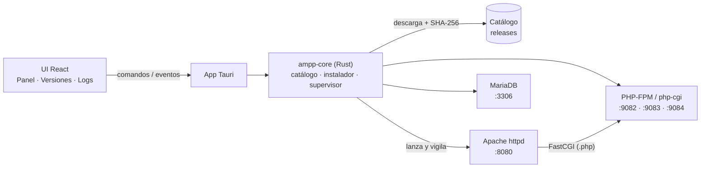

<div align="center">


# Open Ampp

**Apache + MariaDB + PHP para desarrollo local, sin complicaciones.**<br>
Varias versiones de cada herramienta, una app de escritorio amigable y el mismo flujo en Windows, macOS y Linux.

[](https://github.com/Jmzp/open-ampp/actions/workflows/ci.yml)
[](https://github.com/Jmzp/open-ampp/actions/workflows/binaries.yml)


</div>

---

## ✨ ¿Qué es?

Open Ampp es una alternativa moderna a XAMPP / MAMP / LAMPP. Abres la app, eliges qué versiones quieres y con un clic tienes un servidor web con PHP y una base de datos funcionando en tu máquina.

- 🧩 **Multiversión** — instala PHP 8.2, 8.3 y 8.4 (y varias versiones de MariaDB) lado a lado y cambia entre ellas cuando quieras.
- 📦 **Nada que instalar en el sistema** — la app descarga sus propios binarios portables, verificados con SHA-256, dentro de su carpeta de datos. No toca Homebrew, `apt` ni el registro de Windows.
- 🖥️ **UI clara** — panel con el estado de cada servicio, botones de iniciar/detener, logs en vivo y gestor de versiones con progreso de descarga.
- 🛡️ **Seguro por defecto** — los servicios escuchan solo en `127.0.0.1`, en puertos sin privilegios (8080, 3306, 90xx).
- 🧹 **Apagado limpio** — al cerrar la app se detienen todos los servicios; MariaDB siempre se apaga de forma ordenada.

## 🧭 Plataformas y versiones

| | Windows x64 | macOS (Intel / Apple Silicon) | Linux (x64 / arm64) |
|---|:---:|:---:|:---:|
| **PHP** 8.2 · 8.3 · 8.4 | ✅ | ✅ | ✅ |
| **MariaDB** 10.11 · 11.4 · 11.8 (LTS) | ✅ | ✅ | ✅ |
| **Apache** 2.4 | ✅ | ✅ | ✅ |

> En Windows se usan los binarios oficiales (php.net, mariadb.org, Apache Lounge). En macOS y Linux, donde no existen builds portables oficiales, Open Ampp publica los suyos — ver [Binarios propios](#-binarios-propios). En Linux funcionan en cualquier distro con glibc ≥ 2.28 (Ubuntu 20.04+, Debian 10+, RHEL/Alma/Rocky 8+, Fedora, Arch…).
>
> **Estado de las pruebas:** el stack completo está probado de punta a punta en macOS (Apple Silicon) y en Linux arm64 (Ubuntu 24.04). Windows y las variantes x64 de macOS/Linux se compilan en CI pero aún no se han probado en máquinas reales: si las usas, [cuéntanos cómo te va](https://github.com/Jmzp/open-ampp/issues).

## 🚀 Empezar

> Todavía no hay instaladores publicados (llegan en la fase de distribución). Por ahora se ejecuta desde el código.

**Requisitos:** [Rust](https://rustup.rs) estable, [Node.js](https://nodejs.org) 22 y las [dependencias de Tauri](https://tauri.app/start/prerequisites/) de tu sistema.

```sh
git clone https://github.com/Jmzp/open-ampp.git
cd open-ampp/apps/desktop
npm install
npm run tauri dev
```

Luego, en la app:

1. **Versiones** → instala una versión de PHP, Apache y MariaDB.
2. **Panel** → **Iniciar todo**.
3. Abre **http://localhost:8080** — verás la página de bienvenida servida por PHP.

Tus archivos van en la carpeta `www/` dentro del directorio de datos (la ruta aparece al pie de la app). MariaDB queda accesible en `127.0.0.1:3306` con usuario `root` sin contraseña.

## 🏗️ Cómo funciona



- **PHP vía FastCGI, no `mod_php`**: cada versión de PHP corre en su propio puerto (`9000 + mayor·10 + menor`, p. ej. 8.3 → 9083) y Apache le pasa los `.php` con `mod_proxy_fcgi`. Así pueden convivir varias versiones a la vez.
- **Toda la lógica vive en `ampp-core`**, un crate de Rust sin dependencia de Tauri: se puede probar de forma aislada y reutilizar desde un CLI.
- **Configuración generada** desde [`templates/`](templates) en cada arranque, en la carpeta de datos del usuario.

<details>
<summary><b>📁 Dónde guarda las cosas</b></summary>

| Sistema | Carpeta de datos |
|---|---|
| macOS | `~/Library/Application Support/dev.openampp.open-ampp/` |
| Linux | `~/.local/share/open-ampp/` (o `$XDG_DATA_HOME/open-ampp`) |
| Windows | `%APPDATA%\openampp\open-ampp\data\` |

```text
bin/<herramienta>/<versión>/   binarios descargados
config/<herramienta>/<versión>/ httpd.conf, php.ini, php-fpm.conf, my.cnf generados
data/mariadb/<mayor.menor>/    datos de MariaDB (uno por versión, para no mezclar formatos)
www/                           tu DocumentRoot
logs/                          un log por servicio (también visibles en la app)
state.json                     versiones instaladas/activas y puertos
```

</details>

## 🗂️ Estructura del repositorio

| Ruta | Contenido |
|---|---|
| [`crates/ampp-core`](crates/ampp-core) | Motor en Rust: rutas, estado, catálogo, instalador, configuración y supervisor de procesos |
| [`apps/desktop`](apps/desktop) | App Tauri 2 (`src-tauri/`) y UI React + TypeScript (`src/`) |
| [`templates`](templates) | Plantillas de `httpd.conf`, `php.ini`, `php-fpm.conf` y `my.cnf` |
| [`catalog`](catalog) | `manifest.json` con las versiones descargables y su generador |
| [`binaries`](binaries) | Scripts que compilan Apache/MariaDB portables y re-empaquetan PHP |
| [`.github/workflows`](.github/workflows) | CI (tests en las 3 plataformas) y build/publicación de binarios |

## 🧪 Desarrollo y pruebas

```sh
cargo test -p ampp-core                                   # tests unitarios (rápidos, sin red)
cargo test -p ampp-core -- --ignored                      # descarga PHP real, lo arranca y le hace una petición FastCGI
cd apps/desktop && npm run build                          # compila la UI
```

Prueba de punta a punta del stack completo con paquetes locales (Apache sirve PHP, PHP consulta MariaDB por PDO):

```sh
OPEN_AMPP_APACHE_PKG=dist/apache-….tar.gz \
OPEN_AMPP_PHP_PKG=dist/php-….tar.gz \
OPEN_AMPP_MARIADB_PKG=dist/mariadb-….tar.gz \
  cargo test -p ampp-core --test stack -- --ignored --nocapture
```

## 📦 Binarios propios

Apache y MariaDB no publican builds portables para macOS ni Linux, así que Open Ampp los compila con los scripts de [`binaries/`](binaries) y los publica como releases `bin-<herramienta>-<versión>` desde el workflow **Binarios** (ejecución manual).

- **Relocalizables**: funcionan desde cualquier carpeta (`@rpath` en macOS, `$ORIGIN` en Linux).
- **Autocontenidos**: OpenSSL, PCRE2 y expat se enlazan estáticamente; en Linux las librerías que no son de glibc se incluyen en el paquete. El build falla si detecta cualquier dependencia que no exista en un sistema limpio (p. ej. librerías de Homebrew).
- **Compatibles**: Linux se compila sobre AlmaLinux 8 (glibc 2.28); macOS apunta a macOS 11+.
- **Verificados**: las fuentes se comprueban contra los SHA-256 oficiales ([`binaries/sources.sh`](binaries/sources.sh)).

```sh
WORK=/tmp/ampp-build binaries/build-apache.sh dist
WORK=/tmp/ampp-build binaries/build-mariadb.sh 11.4.13 dist   # requiere cmake ≥ 3.23 y bison ≥ 3
WORK=/tmp/ampp-build binaries/repack-php.sh 8.4.23 dist
```

Tras publicar nuevas releases, regenera el catálogo:

```sh
python3 catalog/generate.py
```

El generador prioriza los binarios propios y usa fuentes oficiales de terceros para el resto, tomando sus checksums publicados (o calculándolos cuando la fuente no los publica).

## 🗺️ Hoja de ruta

- [x] **Fundaciones** — monorepo, `ampp-core`, app Tauri + React, CI en las 3 plataformas
- [x] **Catálogo e instalador** — descargas con progreso, verificación SHA-256, gestor de versiones
- [x] **Servicios** — Apache + PHP (FastCGI) + MariaDB, health checks, logs en vivo, apagado limpio
- [x] **Binarios propios** — Apache, MariaDB y PHP (CLI + FPM) portables para macOS y Linux
- [ ] **Proyectos** — dominios `*.localhost`, versión de PHP por proyecto, HTTPS con CA local
- [ ] **Pulido** — icono en la bandeja, editor de `php.ini` y extensiones, Adminer, Composer, CLI `ampp`
- [ ] **Distribución** — instaladores firmados (MSI, DMG, AppImage/deb/rpm) y auto-actualización

## 🤝 Contribuir

¡Las contribuciones son bienvenidas! Abre un issue para reportar un problema o proponer una idea, o envía un pull request. Antes de enviarlo, verifica que pasen `cargo test -p ampp-core` y `npm run build` en `apps/desktop`.
