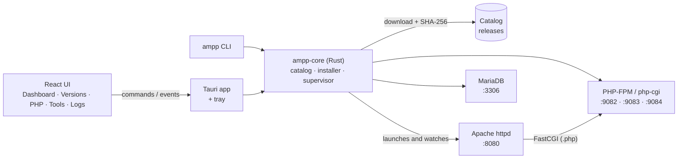

<div align="center">


# Open AMPP

**Apache + MariaDB + PHP for local development, without the hassle.**<br>
Several versions of each tool, a friendly desktop app, and the same workflow on Windows, macOS and Linux.

**English** · [Español](README.es.md)

[](https://github.com/Jmzp/open-ampp/actions/workflows/ci.yml)
[](https://github.com/Jmzp/open-ampp/actions/workflows/binaries.yml)


<br><br>


</div>

---

## ✨ What is it?

Open AMPP is a modern take on XAMPP / MAMP / LAMPP. Open the app, pick the versions you want, and one click later you have a web server with PHP and a database running on your machine.

- 🧩 **Multi-version**: install PHP 8.2, 8.3, 8.4 and 8.5 (and several MariaDB versions) side by side and switch whenever you like.
- 🌐 **Projects**: serve any folder at its own `*.localhost` domain, each with its own PHP version and optional HTTPS, with no hosts file to edit.
- 🐘 **XAMPP-flavoured PHP**: the default `php.ini` is XAMPP's, with its extensions (`mysqli`, `pdo_mysql`, `mbstring`, `curl`, `openssl`…) plus `intl`, `gd`, `zip`, `sodium` and `opcache`.
- 🗄️ **phpMyAdmin and Composer** one click away, already wired to the active versions.
- 📬 **Mailpit**: the mail your projects send with `mail()` lands in a local web inbox instead of failing or reaching real people.
- 📦 **Nothing installed system-wide**: the app downloads its own portable, SHA-256-verified binaries into its data folder. It does not touch Homebrew, `apt` or the Windows registry.
- 🖥️ **Clear UI** in English and Spanish (it follows your system language): live service status, start/stop, logs, version manager, `php.ini` editor and a tray icon.
- ⌨️ **`ampp` command** for the terminal, plus `php`, `composer` and `mariadb` shims that always use the active versions.
- 🛡️ **Safe by default**: services listen on `127.0.0.1` only, on unprivileged ports (8080, 3306, 90xx).
- 🧹 **Clean shutdown**: quitting the app stops everything it started; MariaDB is always shut down gracefully.
- 🔒 **Security patches without waiting**: new PHP patch releases are built automatically every day; the app picks up the updated catalog and offers **Update to …** for your installed versions.
- 🔄 **Auto-updates** of the app itself through signed releases.

## 🧭 Platforms and versions

| | Windows x64 | macOS (Intel / Apple Silicon) | Linux (x64 / arm64) |
|---|:---:|:---:|:---:|
| **PHP** 8.2 · 8.3 · 8.4 · 8.5 | ✅ | ✅ | ✅ |
| **MariaDB** 10.11 · 11.4 · 11.8 · 12.3 (LTS) | ✅ | ✅ | ✅ |
| **Apache** 2.4 | ✅ | ✅ | ✅ |
| **phpMyAdmin** · **Composer** | ✅ | ✅ | ✅ |

> [!IMPORTANT]
> **Windows requirement: Microsoft Visual C++ Redistributable (x64).** Windows uses the official builds (php.net, mariadb.org, Apache Lounge), which depend on it. Most PCs already have it; if yours does not, Open AMPP tells you when starting the services.
>
> **[Download vc_redist.x64.exe](https://aka.ms/vs/17/release/vc_redist.x64.exe)** (direct link from Microsoft) · [more info](https://learn.microsoft.com/cpp/windows/latest-supported-vc-redist)

> On macOS and Linux, where there are no official portable builds, Open AMPP publishes its own (see [Our own binaries](#-our-own-binaries)). On Linux they run on any distro with glibc ≥ 2.28 (Ubuntu 20.04+, Debian 10+, RHEL/Alma/Rocky 8+, Fedora, Arch…); PHP is fully static.
>
> **Testing status:** the whole stack (Apache, PHP, MariaDB and phpMyAdmin) is tested end to end on macOS (Apple Silicon), Linux arm64 (Ubuntu 24.04) and Windows 11 x64. The x64 builds for macOS and Linux are built in CI but have not been tried on real machines yet. If you use them, [tell us how it goes](https://github.com/Jmzp/open-ampp/issues).

## 🚀 Getting started

### Installers

**Latest version: [v0.2.0](https://github.com/Jmzp/open-ampp/releases/tag/v0.2.0)**. Pick your system and click to download:

| System | Download |
|---|---|
| 🍎 **macOS** Apple Silicon (M1/M2/M3/M4) | [Open.AMPP_0.2.0_aarch64.dmg](https://github.com/Jmzp/open-ampp/releases/download/v0.2.0/Open.AMPP_0.2.0_aarch64.dmg) |
| 🍎 **macOS** Intel | [Open.AMPP_0.2.0_x64.dmg](https://github.com/Jmzp/open-ampp/releases/download/v0.2.0/Open.AMPP_0.2.0_x64.dmg) |
| 🪟 **Windows** x64 (installer) | [Open.AMPP_0.2.0_x64-setup.exe](https://github.com/Jmzp/open-ampp/releases/download/v0.2.0/Open.AMPP_0.2.0_x64-setup.exe) · or [`.msi`](https://github.com/Jmzp/open-ampp/releases/download/v0.2.0/Open.AMPP_0.2.0_x64_en-US.msi) |
| 🐧 **Linux** x64 · Ubuntu / Debian | [Open.AMPP_0.2.0_amd64.deb](https://github.com/Jmzp/open-ampp/releases/download/v0.2.0/Open.AMPP_0.2.0_amd64.deb) |
| 🐧 **Linux** x64 · Fedora / RHEL | [Open.AMPP-0.2.0-1.x86_64.rpm](https://github.com/Jmzp/open-ampp/releases/download/v0.2.0/Open.AMPP-0.2.0-1.x86_64.rpm) |
| 🐧 **Linux** x64 · any distro | [Open.AMPP_0.2.0_amd64.AppImage](https://github.com/Jmzp/open-ampp/releases/download/v0.2.0/Open.AMPP_0.2.0_amd64.AppImage) |
| 🐧 **Linux** arm64 · Ubuntu / Debian | [Open.AMPP_0.2.0_arm64.deb](https://github.com/Jmzp/open-ampp/releases/download/v0.2.0/Open.AMPP_0.2.0_arm64.deb) |
| 🐧 **Linux** arm64 · Fedora / RHEL | [Open.AMPP-0.2.0-1.aarch64.rpm](https://github.com/Jmzp/open-ampp/releases/download/v0.2.0/Open.AMPP-0.2.0-1.aarch64.rpm) |
| 🐧 **Linux** arm64 · any distro | [Open.AMPP_0.2.0_aarch64.AppImage](https://github.com/Jmzp/open-ampp/releases/download/v0.2.0/Open.AMPP_0.2.0_aarch64.AppImage) |

> Not sure which Mac you have? Apple menu → **About This Mac**: "Apple M…" means Apple Silicon, "Intel" means Intel.
>
> The other files in a release (`.sig`, `.app.tar.gz`, `latest.json`) are used by the auto-updater; you don't need them. Older versions are in [Releases](https://github.com/Jmzp/open-ampp/releases).

> Until the builds are signed with an Apple Developer ID, macOS asks for confirmation the first time: right-click the app → **Open**.

### From source

**Requirements:** [Rust](https://rustup.rs) stable, [Node.js](https://nodejs.org) 22 and the [Tauri prerequisites](https://tauri.app/start/prerequisites/) for your system.

```sh
git clone https://github.com/Jmzp/open-ampp.git
cd open-ampp/apps/desktop
npm install
npm run tauri dev
```

### First steps

1. **Versions** → install a PHP, Apache and MariaDB version.
2. **Dashboard** → **Start all**.
3. Open **http://localhost:8080**: the welcome page is served by PHP.
4. Optional: **Tools** → install **phpMyAdmin** (at `/phpmyadmin`), **Composer** and **Mailpit** (inbox at http://localhost:8025).

Your files go in the `www/` folder inside the data directory (the app has a button to open it). MariaDB listens on `127.0.0.1:3306` with user `root` and no password (you can set one on the dashboard or with `ampp root-password`; each MariaDB series keeps its own, since each has its own data); with PHP on macOS/Linux, `localhost` also works through the socket, just like XAMPP.

Closing the window keeps Open AMPP in the system tray with the services running; **Quit** in the tray menu stops them.

## ⌨️ Terminal

**Tools → Terminal → Add to PATH** sets up these commands in any new terminal:

| Command | What it runs |
|---|---|
| `php`, `composer` | The active PHP with Open AMPP's `php.ini` |
| `mariadb`, `mysql`, `mariadb-dump`, `mysqldump` | The active MariaDB client, already connected as root |
| `ampp` | Controls Open AMPP without opening the app |

```sh
ampp status                 # service status (also the ones started by the app)
ampp up                     # start everything in the foreground; Ctrl+C stops it
ampp stop [apache|php|mariadb|mailpit]
ampp list                   # installed and available versions
ampp install php            # latest PHP; also: ampp install mariadb 11.4.13, ampp install phpmyadmin, ampp install mailpit
ampp upgrade                # move installed versions to their newest patch release
ampp use php 8.3.36         # active version
ampp project add blog ~/sites/blog/public --php 8.2   # http://blog.localhost:8080
ampp project ls             # also: ampp project rm blog
ampp project add shop ~/sites/shop --https            # https://shop.localhost:8443
ampp trust                  # trust the local CA that signs the HTTPS projects
ampp root-password s3cret   # MariaDB root password (no argument removes it)
ampp php -v                 # passthrough to the active PHP (same for composer and mariadb)
```

The app and `ampp` share their state: what one starts, the other sees and can stop.

## 🌐 Projects

The **Projects** tab serves any folder at its own domain, such as `http://blog.localhost:8080`, with the PHP version you choose (or the active one). Several versions run side by side: each PHP series a project needs gets its own FastCGI process, and Apache routes each domain to it with a virtual host.

- `*.localhost` domains point to `127.0.0.1` in Chrome, Firefox, Edge and `curl` with no setup. Other domains (e.g. `blog.test`) need a hosts file entry.
- A project stores the PHP **series** (`8.2`), so `ampp upgrade` and **Update to …** keep it working.
- `localhost` and any unknown domain keep serving `www/` and phpMyAdmin.
- Removing a project only stops serving it: its folder is never deleted.

### 🔒 HTTPS

Tick **Also serve over HTTPS** on a project and it is also served at `https://<domain>:8443`. Open AMPP creates a certificate authority (CA) for your machine the first time, and one certificate for the HTTPS domains, renewed by itself.

- The CA carries **name constraints**: it can only sign `localhost`, `*.localhost` and `127.0.0.0/8`. Trusting it puts no other site at risk, even if its key were stolen. For the same reason HTTPS is only offered for `.localhost` domains.
- **Trust the local CA** (in the Projects tab, or `ampp trust`) adds it to your user's trust store: the login keychain on macOS (it asks for your password), the current user's store on Windows (it asks for confirmation). No administrator rights are needed. Restart the browser afterwards.
- On Linux the app shows the `sudo` commands to add it to the system store and to the NSS store that Chrome and Firefox use.
- Firefox may keep its own store: if it still warns, import `certs/local/ca.pem` in **Settings → Privacy & Security → Certificates**.
- `mod_ssl` is only loaded when some project uses HTTPS, so plain HTTP never depends on it.

## 📬 Mail (Mailpit)

Install **Mailpit** in **Tools** and every message PHP sends with `mail()` (or a framework's `sendmail` transport) is caught and shown at **http://localhost:8025**. Nothing leaves your machine.

- It starts and stops with the other services (**Start all**, `ampp up`), and has its own row on the dashboard.
- PHP is wired to it automatically: `sendmail_path` on macOS and Linux, `SMTP`/`smtp_port` on Windows. Frameworks that speak SMTP can use `127.0.0.1:1025` with no user or password (in Laravel: `MAIL_MAILER=smtp`, `MAIL_HOST=127.0.0.1`, `MAIL_PORT=1025`).
- Messages are kept in `data/mailpit/` between restarts.

## 🐘 PHP configuration

The **PHP** tab edits the usual settings (memory, upload size, execution time, errors, time zone), toggles extensions on Windows (on macOS/Linux they are built in), and accepts free-form `php.ini` lines. Your changes are appended to the end of XAMPP's `php.ini`, so they win, and PHP restarts by itself to apply them.

## 🏗️ How it works



- **PHP over FastCGI, not `mod_php`**: each PHP version runs on its own port (`9000 + major·10 + minor`, e.g. 8.3 → 9083) and Apache hands `.php` files to it through `mod_proxy_fcgi`, so several versions can coexist.
- **All the logic lives in `ampp-core`**, a Rust crate with no Tauri dependency, shared by the app and the `ampp` CLI.
- **Generated configuration** from [`templates/`](templates) on every start, inside the user's data folder.

<details>
<summary><b>📁 Where things are stored</b></summary>

| System | Data folder |
|---|---|
| macOS | `~/Library/Application Support/dev.openampp.open-ampp/` |
| Linux | `~/.local/share/open-ampp/` (or `$XDG_DATA_HOME/open-ampp`) |
| Windows | `%APPDATA%\openampp\open-ampp\data\` |

Set `OPEN_AMPP_HOME` to use another folder (portable installs, tests).

```text
bin/<tool>/<version>/       downloaded binaries
config/<tool>/<version>/    generated httpd.conf, php.ini, php-fpm.conf, my.cnf
data/mariadb/<major.minor>/ MariaDB data (one per version so formats never mix)
tools/                      phpMyAdmin, Composer and Mailpit
shims/                      php, composer, mariadb, ampp… for the terminal
certs/local/                local CA and the HTTPS certificate of the projects
www/                        your DocumentRoot
logs/                       one log per service (also visible in the app)
state.json                  installed/active versions, ports and PHP settings
```

</details>

## 🗂️ Repository layout

| Path | Contents |
|---|---|
| [`crates/ampp-core`](crates/ampp-core) | Rust engine: paths, state, catalog, installer, config, process supervisor, shims, i18n |
| [`crates/ampp-cli`](crates/ampp-cli) | The `ampp` command |
| [`apps/desktop`](apps/desktop) | Tauri 2 app (`src-tauri/`) and React + TypeScript UI (`src/`) |
| [`templates`](templates) | `httpd.conf`, `php.ini` (XAMPP's), `php-fpm.conf` and `my.cnf` templates |
| [`catalog`](catalog) | `manifest.json` with the downloadable versions (only the newest patch of each series), and its generator |
| [`binaries`](binaries) | Scripts that build portable Apache, MariaDB and PHP |
| [`.github/workflows`](.github/workflows) | CI, binary builds and installer releases |

## 🧪 Development and tests

```sh
cargo test -p ampp-core -p ampp-cli                       # unit, supervisor and CLI tests (fast, offline)
cargo test -p ampp-core -- --ignored                      # downloads a real PHP, starts it, sends a FastCGI request
cd apps/desktop && npm run build                          # builds the UI
OPEN_AMPP_LANG=en npm run tauri dev                       # force the Rust-side language (es or en)
```

End-to-end test of the full stack with local packages (Apache serves PHP, PHP queries MariaDB through PDO, phpMyAdmin logs in):

```sh
OPEN_AMPP_APACHE_PKG=dist/apache-….tar.gz \
OPEN_AMPP_PHP_PKG=dist/php-….tar.gz \
OPEN_AMPP_MARIADB_PKG=dist/mariadb-….tar.gz \
  cargo test -p ampp-core --test stack -- --ignored --nocapture
```

## 📦 Our own binaries

Apache, MariaDB and PHP have no official portable builds for macOS or Linux, so Open AMPP builds them with the scripts in [`binaries/`](binaries) and publishes them as `bin-<tool>-<version>` releases from the **Binaries** workflow.

- **Always patched**: PHP builds ask php.net for the newest release of each series (8.2, 8.3, 8.4). The workflow runs daily, builds only what is missing, publishes it and refreshes [`catalog/manifest.json`](catalog/manifest.json) on `main`. The app and `ampp` download that catalog on startup (falling back to the bundled copy offline), so security fixes reach users without a new app release. Apache and MariaDB builds are started manually.

- **Relocatable**: they work from any folder (`@rpath` on macOS, `$ORIGIN` on Linux).
- **Self-contained**: OpenSSL, PCRE2 and expat are linked statically; on Linux any non-glibc library ships inside the package, and PHP is fully static ([static-php-cli](https://github.com/crazywhalecc/static-php-cli)). The build fails if it detects a dependency a clean system would not have (e.g. Homebrew libraries).
- **Compatible**: Apache and MariaDB for Linux are built on AlmaLinux 8 (glibc 2.28); macOS targets macOS 11+.
- **Verified**: every source is checked against its official SHA-256 ([`binaries/sources.sh`](binaries/sources.sh)).

```sh
WORK=/tmp/ampp-build binaries/build-apache.sh dist
WORK=/tmp/ampp-build binaries/build-mariadb.sh 11.4.13 dist   # needs cmake ≥ 3.23 and bison ≥ 3
WORK=/tmp/ampp-build binaries/build-php.sh 8.4 dist          # a minor resolves to its newest patch
GH_TOKEN=$(gh auth token) python3 catalog/generate.py         # then refresh the catalog
```

## 🚢 Releases

Pushing a `v*` tag runs the **Release** workflow: it builds the installers for every platform (with the `ampp` CLI bundled), signs the update artifacts and leaves a draft release ready to publish. Updates are signed with the key in the `TAURI_SIGNING_PRIVATE_KEY` secret; the Apple signing and notarization secrets are optional (see [`release.yml`](.github/workflows/release.yml)). When bumping the version, also update the download links in [Installers](#installers), since the file names include the version.

## 🗺️ Roadmap

- [x] **Foundations**: monorepo, `ampp-core`, Tauri + React app, CI on all 3 platforms
- [x] **Catalog and installer**: downloads with progress, SHA-256 verification, version manager, remote catalog with patch updates
- [x] **Services**: Apache + PHP (FastCGI) + MariaDB, health checks, live logs, clean shutdown
- [x] **Our own binaries**: portable Apache, MariaDB and PHP (CLI + FPM) for macOS and Linux
- [x] **Polish**: tray icon, `php.ini` and extensions editor, phpMyAdmin, Composer, `ampp` CLI, English/Spanish UI
- [x] **Distribution**: installers (DMG, MSI/NSIS, AppImage/deb/rpm) and auto-update
- [x] **Projects**: `*.localhost` domains, per-project PHP version
- [x] **HTTPS** for projects with a name-constrained local CA
- [ ] Apple Developer ID and Windows code signing

## 🤝 Contributing

Contributions are very welcome, in English or Spanish: bug reports, tests on real hardware, migration stories from XAMPP/MAMP/Laragon, translations and pull requests.

- 📘 **[Contributing guide](CONTRIBUTING.md)**: setup, where things live, tests and conventions.
- 🐞 **[Report a bug](https://github.com/Jmzp/open-ampp/issues/new?template=bug_report.yml)** or **[suggest an idea](https://github.com/Jmzp/open-ampp/issues/new?template=feature_request.yml)**.
- 🌱 **[Good first issues](https://github.com/Jmzp/open-ampp/labels/good%20first%20issue)** to get started.
- 🔒 Security problems: please report them privately ([SECURITY.md](SECURITY.md)).

Everyone taking part follows the [Code of Conduct](CODE_OF_CONDUCT.md).

## 📄 License

[MIT](LICENSE) © Jorge Zapata and the Open AMPP contributors. Apache, PHP, MariaDB, phpMyAdmin, Composer and Mailpit are distributed under their own licenses.
